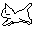

you: hi [terminal draw](https://github.com/lolasanchezz/terminal-draw)!
  terminal draw:

# lola sanchez 

 ++ i like doing macos stuff with go and bubbletea, and the occasional low level project (see [ntwatch](https://github.com/lolasanchezz/ntwatch), [journalcli](https://github.com/lolasanchezz/journalcli), [terminal-draw](https://github.com/lolasanchezz/terminal-draw))   
 ++ and making small websites (see [cybersigilism](https://github.com/lolasanchezz/cybersigilism), [stipple-cats](https://github.com/lolasanchezz/blot-cats))   
 ++ and the occasional data science project (see [live-photo-mosaic](https://github.com/lolasanchezz/live-photo-mosaic))   
 ++ i also made [snowglobe](https://snowglobe.hackclub.com), a full stack website to qualify on for a 3 day hackathon at Notion HQ   
→ currently working at Hack Club as the technical lead of the [Athena Initative](https://athena.hackclub.com).   
→ [more here](https://lolas.website) 
